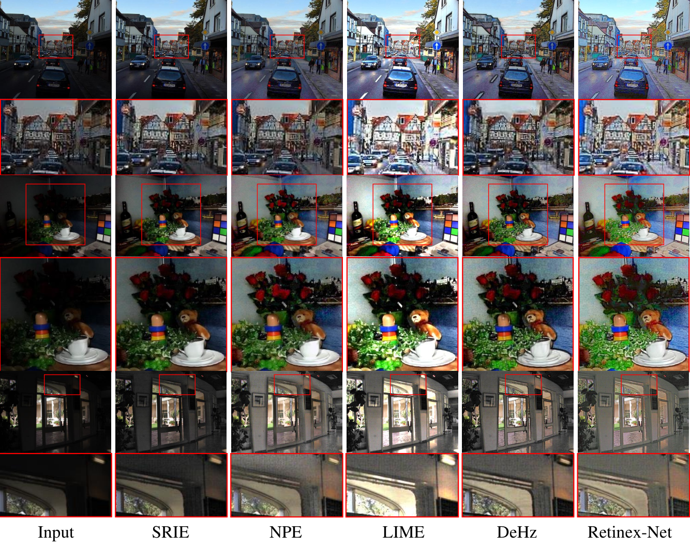

# RetinexNet 与 LIME 低照度图像增强实验

本项目用于课程作业中的 RetinexNet 复现及 LIME Baseline 对比。RetinexNet 基于 [Chen Wei 等人的上游 TensorFlow 实现](https://github.com/weichen582/RetinexNet)，论文为 [Deep Retinex Decomposition for Low-Light Enhancement，BMVC 2018](https://arxiv.org/abs/1808.04560)。原项目与数据入口见 [Project Page & Dataset](https://daooshee.github.io/BMVC2018website/)。

本发布目录保留训练、测试、指标和绘图代码、LIME 实现与已有结果、一套完成训练的最佳权重和实验记录，**并包含当前实验所用的训练集和测试集**：485 对训练图及 15 对测试图，共 1,000 张 PNG。下载完整目录并按下文配置 Python 3.7 和依赖后，即可运行默认测试，也可以从头重新训练，无需另行下载或摆放数据。数据组成与原始出处见 [DATASET.md](DATASET.md)。

保留与排除的内容见 [整理说明](整理说明.md)，发布副本的实际检查结果见 [验证记录](验证记录.md)。文件完整性可按 [文件清单_SHA256.csv](文件清单_SHA256.csv) 核对。

## 环境准备

代码使用 TensorFlow 1.x 原生接口。已有实验的本地环境为 Python **3.7.16**、TensorFlow **1.15.5**、NumPy **1.18.5**、Pillow **9.5.0**、protobuf **3.20.3**；同一环境的 Matplotlib **3.5.3** 可用于绘图。依赖版本写在 [requirements.txt](requirements.txt)，按本地已安装环境固定；本次未进行联网安装或全新环境重建验证。

在 Anaconda Prompt 中进入本 README 所在目录，再创建环境并安装依赖：

```bat
conda create -n retinex-tf1 python=3.7.16 pip
conda activate retinex-tf1
python -m pip install -r requirements.txt
```

Python 版本由 Conda 环境指定，不能通过 `requirements.txt` 设置。该清单保留项目的直接依赖及 TensorFlow 相关兼容约束，并非完整 Conda 环境镜像。TensorFlow 1.x 的安装包需要与操作系统和 Python 版本匹配；本地实验使用 Windows 64 位 CPU 环境。默认 `--use_gpu=0`；仅在已配置兼容 TensorFlow 1.x 的 CUDA 环境时使用 `--use_gpu=1`。

## 使用已附最佳权重测试

发布目录已附以下完整训练记录所需的最佳 Decom、Relight 权重及 `latest.json` 指针，路径已按发布目录整理：

```text
runs/2026-11-03/20261103_110748_560831/
  config.json
  checkpoints/best/Decom/
  checkpoints/best/Relight/
  train.log
  loss.csv
  epochs.csv
  test_results/
```

测试输入 `data/eval/low/` 和同名参考图 `data/eval/high/` 已包含在发布目录中。完成上述环境配置后，在项目根目录执行：

```bat
conda activate retinex-tf1
python test_latest.py
```

这会直接加载已附最佳权重，不启动训练；也可运行 `python main.py --phase=test`。每次独立测试在该训练目录下新建 `tests/YYYY-MM-DD/run-id/`，保存增强图、测试日志、配置和误差指标。已有 `test_results/` 是原实验成果。

更换测试图和参考图时可显式传入路径：

```bat
python test_latest.py --test_dir "D:\images\low" --reference_dir "D:\images\high"
```

参考图应与输入图完整同名、同尺寸。缺少参考图时仍可生成增强结果，但相应指标会记为不可用。指定本仓库所附实验可使用：

```bat
python test_latest.py --run_dir "runs/2026-11-03/20261103_110748_560831"
```

`latest.json` 在完成新的训练后会改为指向新实验；独立测试使用它当前指向的完整训练。不要单独移动或只保留某一个阶段的权重。

## 从头训练

发布目录已包含 `data/our485/{low,high}` 的 485 对训练图及 `data/eval/{low,high}` 的 15 对测试图。完成上述环境配置后，在项目根目录执行：

```bat
python main.py
```

默认 Decom 和 Relight **各训练 100 轮**，每次调用都从头开始，建立独立运行目录，不自动续训或覆盖已附实验。训练只读取 `our485`，不合并其他数据；`eval` 不参与参数更新或最佳模型选择。每个阶段按逐轮平均训练损失最低选择最佳参数，Relight 使用选出的最佳 Decom 训练。两个阶段完成后自动测试最终测试集。

默认参数及可覆盖示例：

```bat
python main.py --epoch=100 --batch_size=16 --patch_size=48 --start_lr=0.001 --use_gpu=0
```

`--epoch` 是每个阶段的轮数。使用 `--data_root` 更换数据根目录，`--output_root` 更换运行归档根目录；使用自定义输出根目录后，独立测试也应提供同一个 `--output_root`。完整参数见 `python main.py --help`。

新训练结果按北京时间保存在 `runs/YYYY-MM-DD/run-id/`，包括日志、批次损失 `loss.csv`、逐轮损失 `epochs.csv`、配置、`checkpoints/best/`、`checkpoints/last/`、训练样图及 `test_results/`。本发布副本仅附所选实验的 best 权重，未附 last 快照和训练样图。

## 指标与已有结果

RetinexNet 测试将保存后的 `_S` 增强图与同名参考图转成 RGB，像素除以 255 后计算 MAE/MSE，并保存 `metrics.csv` 和 `metrics_summary.json`。汇总采用逐图等权平均；JSON 另记录按 RGB 像素元素数加权的指标。缺失或不匹配的参考图不以零误差计入平均。

所附实验使用 485 对图训练、15 对图最终测试。最佳 Decom 位于第 98 轮、2,940 步，最佳 Relight 位于第 91 轮、2,730 步。对现有保存图按相同口径核验的结果如下：

| 方法 | 有效测试图 | MAE | MSE |
|---|---:|---:|---:|
| RetinexNet | 15/15 | 0.12286475 | 0.02389174 |
| LIME 现有结果 | 15/15 | 0.12054261 | 0.02428075 |

以上是已保存结果的指标，不表示发布整理时重新训练或生成了图像。LIME 现有结果缺少独立的生成参数记录，不能直接将其归因于脚本当前参数。代码未固定 Python、NumPy、TensorFlow 随机种子，重新训练不保证逐次得到相同权重和数值。

## 绘制损失曲线

使用同一 `retinex-tf1` 环境，从所附实验的日志绘图：

```bat
python plot_loss.py "runs/2026-11-03/20261103_110748_560831/train.log"
python plot_loss.py "runs/2026-11-03/20261103_110748_560831/train.log" --x-axis=batch
```

默认按 epoch 计算已记录 batch 的平均损失，在日志旁生成 `loss_curve.png`。绘图不加载 TensorFlow 权重，也不启动训练。新训练完成后可用 `python plot_loss.py` 选择最近一次完整实验；显式传入日志可固定所绘实验。

发布副本已附本次日志生成的 [损失曲线](runs/2026-11-03/20261103_110748_560831/loss_curve.png)。

## LIME Baseline

MATLAB 入口为 `LIME/demo_LIME.m`，核心算法为 `LIME/lime_enhance.m`。这是无训练的传统增强算法，当前实现**没有使用 BM3D**。发布目录包含 15 张 `LIME/results_lol/` 增强图，脚本默认复用它们并计算指标，不重新增强、不应用当前参数。重新生成的方法及实现范围见 [LIME/README.md](LIME/README.md)。

## 来源与引用

data文件来源： https://pan.baidu.com/s/1DaIjwzIOtel1990njctn2w?pwd=ia2w 

下图由原 RetinexNet 项目提供，用于介绍方法，**不是本次训练结果**：



上游源码的 MIT 许可证及 Chen Wei 版权声明保留于 [LICENSE](LICENSE)。已附数据的组成与原始出处见 [DATASET.md](DATASET.md)。本目录的 LIME 是课程 Baseline 实现；尚未对照作者源码验证一致性，其来源及使用范围说明见 [LIME/README.md](LIME/README.md)。

```bibtex
@inproceedings{Chen2018Retinex,
  title={Deep Retinex Decomposition for Low-Light Enhancement},
  author={Chen Wei and Wenjing Wang and Wenhan Yang and Jiaying Liu},
  booktitle={British Machine Vision Conference},
  year={2018},
  organization={British Machine Vision Association}
}
```
